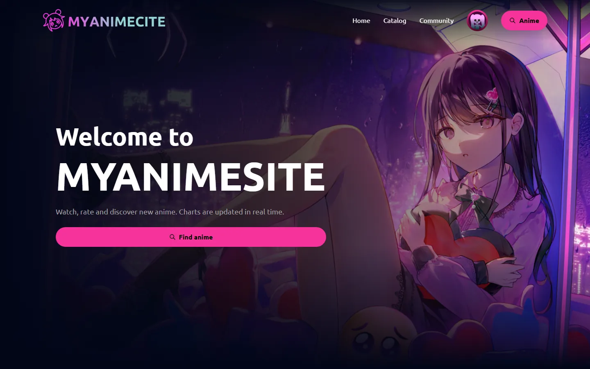
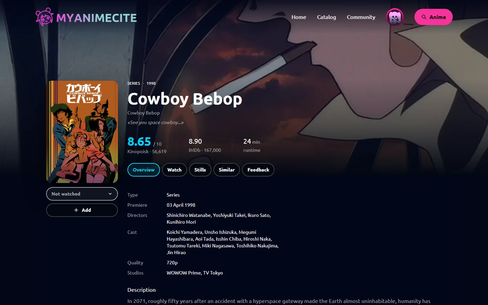
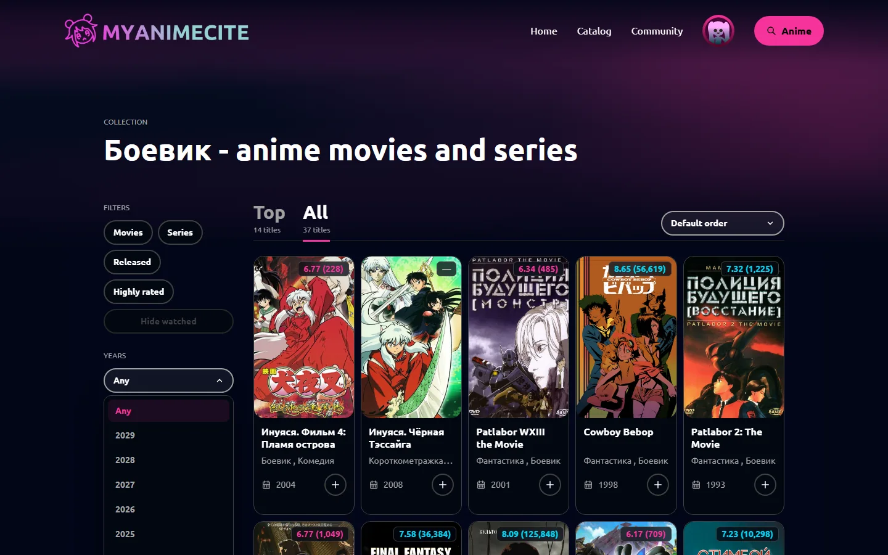
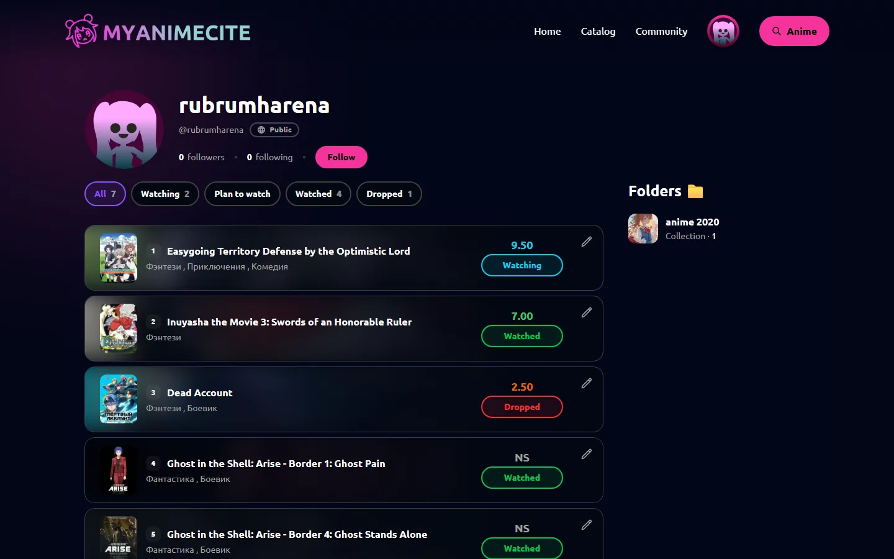
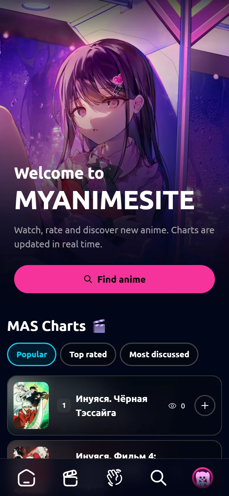
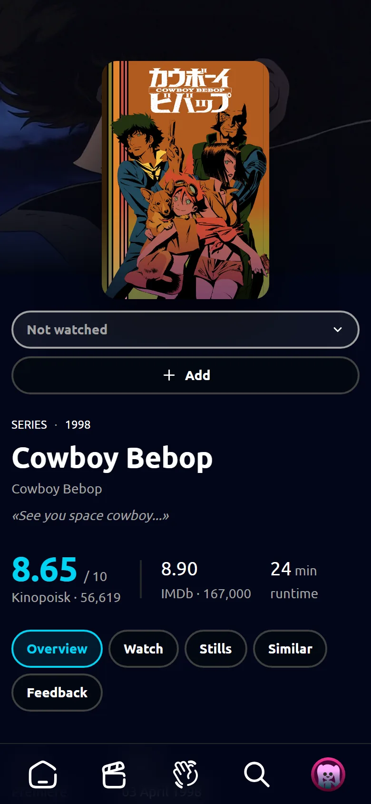
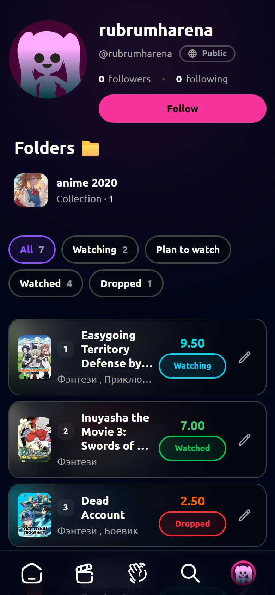

# 🎬 MYANIMESITE

[](https://github.com/rubrumharena/myanimesite/actions/workflows/ci.yaml)


A Django-based modular monolith for anime viewers: a catalog with advanced filtering and full-text search, personal
folders, watch history, reviews, followers and paid subscriptions. Title data is aggregated from the Kinopoisk and
TMDB APIs and kept up to date by background jobs.

🌐 **Live demo:** [rubrumharena.me](https://rubrumharena.me/)
> The project is under active development.

## 📸 Screenshots

<table>
  <tr>
    <td width="50%"></td>
    <td width="50%"></td>
  </tr>
  <tr>
    <td align="center">Home page with parallax banner</td>
    <td align="center">Title page</td>
  </tr>
  <tr>
    <td width="50%"></td>
    <td width="50%"></td>
  </tr>
  <tr>
    <td align="center">Collection with filters</td>
    <td align="center">Profile with library and folders</td>
  </tr>
</table>

The interface is fully responsive — on phones the navigation moves to a bottom tab bar:

<table>
  <tr>
    <td width="33%"></td>
    <td width="33%"></td>
    <td width="33%"></td>
  </tr>
</table>

## 🔧 Under the Hood

The parts that were the most interesting to build:

- **Caching with targeted invalidation.** Charts, comment trees and folders are cached in Redis under structured keys
  (`v1:comments:title:<id>:…`). Model signals drop only the affected keys by pattern instead of flushing the cache.
- **Background jobs.** Celery handles emails, title imports from Kinopoisk / TMDB, poster loading and Elasticsearch
  indexing; Celery beat refreshes the catalog on a schedule.
- **Search.** Titles and users are indexed in Elasticsearch; the index is kept in sync through signals and tasks.
- **Payments.** Stripe Checkout for subscriptions, with state changes driven by signed webhooks.
- **Nested comments.** Comment trees of any depth are loaded level by level — one query per nesting level, not per
  comment.
- **Image pipeline.** Uploaded avatars and covers are validated, resized, and HEIC photos from iPhones are converted to
  JPEG so every browser can display them.
- **Internationalization.** Russian / English UI via Django i18n; model fields are translated with
  `django-modeltranslation`.
- **CI/CD.** Every push to `main` is linted, tested, built into a multi-arch Docker image and deployed automatically.

## 📦 Tech Stack

**Server:** Python 3.11, Django 5.2, PostgreSQL, Redis, Celery, Gunicorn, WhiteNoise

**Integrations:** Stripe, Elasticsearch, OAuth2 (Google, GitHub), Kinopoisk API, TMDB

**Client:** JavaScript, TailwindCSS, Flowbite, Django Templates

**Infrastructure:** Docker, Docker Compose, Nginx, Let's Encrypt, GitHub Actions

## ✨ Features

- Catalog with advanced filtering and sorting
- Full-text search of titles and users
- Auto-updating charts and recommendations
- Reviews with ratings and threaded comments
- Personal customizable folders for organizing titles
- Watch history and library statuses (watching, planned, watched, dropped)
- Followers / followings and public or private profiles
- Social authentication (Google, GitHub) and email verification
- Subscriptions and payments
- Custom admin interface for importing titles from external APIs
- Russian / English interface
- Responsive layout for desktop and mobile

## 🗂️ Project Structure

| App             | Responsibility                                            |
|-----------------|-----------------------------------------------------------|
| `titles`        | Titles catalog, filtering, charts, search documents       |
| `users`         | User profiles, followings / followers, watch history      |
| `accounts`      | Authentication, email verification, password recovery     |
| `lists`         | Personal folders and collections of titles                |
| `comments`      | Reviews and comment trees under the titles                |
| `video_player`  | Video playback                                            |
| `subscriptions` | Stripe subscriptions and webhooks                         |
| `services`      | Kinopoisk / TMDB clients and titles import tasks          |
| `common`        | Shared models, views, utils and validators                |

## 🚦 Running the Project

### 🐳 With Docker (recommended)

1. Clone the repository.
2. Run `cp .env.example .env` and fill in your environment variables (see [Environment](#-environment)).
3. Run `docker compose -f services.local.yaml up --build`.
4. Create a superuser: `docker compose -f services.local.yaml exec web python manage.py createsuperuser`.
5. Open [http://localhost:8000](http://localhost:8000).

This starts the web server, PostgreSQL, Redis, Elasticsearch, a Celery worker and Celery beat. Migrations are applied
and the search index is rebuilt automatically on startup.

### 🖥️ Manually

1. Clone the repository.
2. Create and activate a virtual environment.
3. Run `pip install -r requirements.txt`.
4. Run `npm install` and then `npm run dev` to build and watch TailwindCSS styles.
5. Run `cp .env.example .env` and fill in your environment variables.
6. Start the [integrations](#-integrations) below.
7. Run `python manage.py migrate`.
8. Run `python manage.py search_index --rebuild` to build the Elasticsearch indexes.
9. Run `python manage.py createsuperuser`.
10. Run `python manage.py runserver` and open [http://localhost:8000](http://localhost:8000).

## 🔐 Environment

Copy `.env.example` to `.env`. The main groups of variables:

| Group         | Variables                                                                                     |
|---------------|-----------------------------------------------------------------------------------------------|
| Django        | `DEBUG`, `SECRET_KEY`, `DOMAIN_NAME`                                                          |
| Database      | `POSTGRES_DB`, `POSTGRES_USER`, `POSTGRES_PASSWORD`, `DATABASE_HOST`, `DATABASE_PORT`         |
| External APIs | `KINOPOISK_TOKEN`, `TMDB_API_KEY`                                                             |
| Elasticsearch | `ELASTICSEARCH_HOST`, `ELASTICSEARCH_PORT`, `ELASTICSEARCH_USER`, `ELASTICSEARCH_SECRET`      |
| Redis         | `REDIS_HOST`, `REDIS_PORT`                                                                    |
| Email         | `EMAIL_HOST`, `EMAIL_PORT`, `EMAIL_HOST_USER`, `EMAIL_HOST_PASSWORD`, `EMAIL_USE_TLS`         |
| Stripe        | `STRIPE_PUBLIC_KEY`, `STRIPE_SECRET_KEY`, `STRIPE_WEBHOOK_SECRET`                             |

For Google OAuth, add your client secret JSON file from Google Cloud to the project root separately.

## 🗃️ Integrations

The project requires the following integrations. With Docker they are started for you, except Stripe.

### 🟥 Redis
Run `redis-cli` to make sure the server is up. Redis is used as a cache and as the Celery broker.

### 💚 Celery
With Redis running, start the worker: `celery -A myanimesite worker --pool=solo --loglevel=info` (Windows) or
`celery -A myanimesite worker -l info`.

Periodic tasks (updating titles from external APIs) are scheduled by beat: `celery -A myanimesite beat --loglevel=info`.

### 🔍 Elasticsearch
Search and some other features depend on Elasticsearch indexes. Run it in a container:

```bash
docker run -d \
  --name elasticsearch \
  -p 9200:9200 \
  -p 9300:9300 \
  -e "discovery.type=single-node" \
  -e "xpack.security.enabled=false" \
  elasticsearch/elasticsearch:9.0.3
```

### 💳 Stripe
Run `stripe listen --forward-to localhost:8000/webhook/stripe/` and put the provided webhook secret into `.env`.

### 🌍 Translations
After changing translatable strings:

```bash
python manage.py makemessages -l en --ignore=venv/* --ignore=node_modules/*
python manage.py compilemessages -l en --ignore=venv
```

## 🧪 Testing

Run `python manage.py test` (it can take up to 5 minutes).

Code style is checked with [Ruff](https://docs.astral.sh/ruff/): `ruff check .`

## 🚀 Deployment

The project runs on a VPS behind Nginx with a Let's Encrypt certificate and is available at
[rubrumharena.me](https://rubrumharena.me/).

### ⚙️ CI/CD

Every push to `main` runs the pipeline in `.github/workflows/ci.yaml`:

```
lint → test → build → deploy
```

| Job      | What it does                                                                                              |
|----------|-----------------------------------------------------------------------------------------------------------|
| `lint`   | Checks code style with Ruff                                                                               |
| `test`   | Runs the Django test suite against a PostgreSQL service container                                         |
| `build`  | Builds a multi-arch (`amd64` / `arm64`) Docker image with compiled TailwindCSS and pushes it to Docker Hub, tagged `latest` and with the commit SHA |
| `deploy` | Connects to the server over SSH, pulls the new image, restarts the stack and checks the `/health/` endpoint |

Pull requests run only `lint` and `test`.

The pipeline needs these repository secrets:

| Secret                                   | Description                                   |
|------------------------------------------|-----------------------------------------------|
| `DOCKERHUB_USERNAME`, `DOCKERHUB_TOKEN`  | Docker Hub credentials for pushing the image  |
| `SSH_HOST`, `SSH_USER`                   | Server address and user                       |
| `SSH_PRIVATE_KEY`                        | Base64-encoded private key for SSH access     |

### 🏗️ Production stack

The production stack is described in `services.prod.yaml`:

- `web` — Gunicorn serving the Django app, static files are served by WhiteNoise. Migrations and `collectstatic` run on startup
- `nginx` — reverse proxy on ports 80 / 443: terminates TLS, redirects HTTP to HTTPS, serves user-uploaded media and the certbot webroot
- `worker` / `beat` — Celery worker and scheduler
- `postgres`, `redis`, `elastic` — data services with persistent volumes

### 🖥️ Server setup

One-time setup of a new server (Docker with the Compose plugin must be installed):

1. Create the `~/myanimesite` directory and copy `services.prod.yaml` and `docker/nginx/default.conf` there, keeping the same paths.
2. Create `.env` next to them with production values (`DEBUG=False`, a strong `SECRET_KEY`, `DOMAIN_NAME=https://<your-domain>`, `DATABASE_HOST=postgres`, `REDIS_HOST=redis`, `ELASTICSEARCH_HOST=elastic`, `ELASTICSEARCH_USER=elastic`).
3. Point the domain's DNS `A` record to the server and issue a certificate with certbot (webroot `docker/certbot/www`), so that `/etc/letsencrypt/live/<your-domain>/` exists.
4. Start the stack:

   ```bash
   docker compose -f services.prod.yaml up -d
   ```

5. Build the search index and create a superuser:

   ```bash
   docker compose -f services.prod.yaml exec web python manage.py search_index --rebuild
   docker compose -f services.prod.yaml exec web python manage.py createsuperuser
   ```

After that, every push to `main` updates the server automatically.
